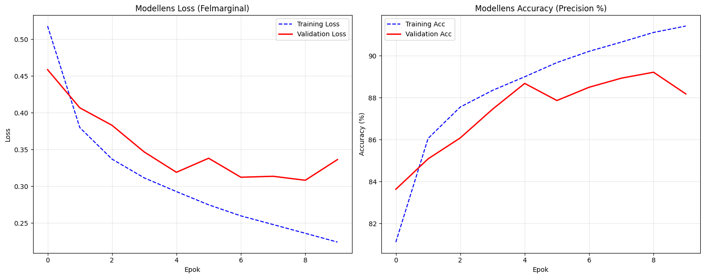
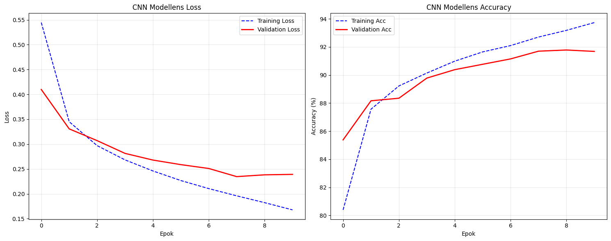
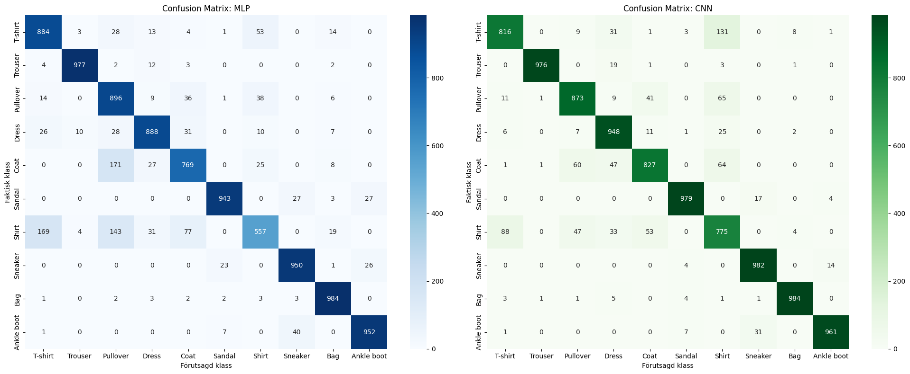

# MLP vs CNN – bildklassificering på Fashion-MNIST

> Grupparbete i par i en universitetskurs i maskininlärning.
> **Min roll:** Jag skrev koden, det vill säga dataförberedelse, modellerna, tränings- och testloopar, visualiseringar och utvärdering. Jag arbetade AI-assisterat med OpenAI Codex. Analysen och slutsatserna gjorde vi tillsammans.

Projektet jämför två neurala nätverksarkitekturer, ett **Multi-Layer Perceptron (MLP)** och ett **Convolutional Neural Network (CNN)**,
på samma bildklassificeringsuppgift. Vi undersöker hur arkitekturen påverkar träffsäkerhet, generalisering och träningsbeteende.

📓 **Notebook:** [`mlp_vs_cnn.ipynb`](mlp_vs_cnn.ipynb)

## Data

[Fashion-MNIST](https://github.com/zalandoresearch/fashion-mnist) innehåller 70 000 gråskalebilder (28×28 pixlar) av klädesplagg i 10 klasser.
Vi valde det i stället för klassiska MNIST eftersom bilderna har mer varierade visuella mönster.

- 54 000 bilder för träning och 6 000 för validering (en 90/10-uppdelning av träningsdatan)
- 10 000 bilder för test
- Normalisering till intervallet [-1, 1], batchstorlek 128

## Modeller

| | MLP | CNN |
|---|---|---|
| **Arkitektur** | 784 → 256 → 256 → 10 (fullt kopplade lager, ReLU) | 2 × [Conv 3×3 → ReLU → MaxPool], med 16 och 32 filter, → 128 → 10 |
| **Parametrar** | 269 322 | 206 922 |

Båda modellerna tränades med samma upplägg: **Adam** (lr 0,001), **CrossEntropyLoss** och **10 epoker** i PyTorch på GPU (Google Colab, T4).

## Resultat

| Modell | Test accuracy | Test loss | Precision (snitt) | Recall (snitt) |
|---|---|---|---|---|
| MLP | 88,00 % | 0,354 | 0,883 | 0,880 |
| **CNN** | **91,21 %** | **0,253** | **0,914** | **0,912** |

### Träningskurvor

**MLP**


**CNN**


### Confusion matrix


## Slutsatser

- **CNN presterade bättre trots färre parametrar.** Faltningslagren hittar lokala mönster som kanter och former, medan MLP ser bilden som en platt vektor och tappar information om vilka pixlar som ligger nära varandra. Arkitekturen betydde mer än antalet parametrar.
- **Överanpassning i båda modellerna.** Den syntes tidigare och tydligare i MLP, där valideringsförlusten började stiga runt epok 5. För CNN kom den runt epok 7–8, och träningen var stabilare.
- **Överdelar var svårast att skilja åt.** Shirt, T-shirt, Pullover och Coat förväxlades oftast. CNN klarade det bättre, till exempel med recall för *Shirt* på 0,78 mot 0,56 för MLP.
- **Fler beräkningar trots färre parametrar.** CNN tränade långsammare på CPU, eftersom faltningar kräver fler beräkningar än MLP:ns matrismultiplikationer.

**Möjliga förbättringar:** early stopping, att spara den bästa modellen enligt valideringsförlusten, dropout eller data augmentation mot överanpassning, och en lägre learning rate för stabilare MLP-träning.

## Kör själv

Öppna notebooken i [Google Colab](https://colab.research.google.com/) eller kör den lokalt:

```bash
pip install -r requirements.txt
jupyter notebook mlp_vs_cnn.ipynb
```

Datasetet laddas ner automatiskt via `torchvision`.

## Teknik

Python · PyTorch · torchvision · scikit-learn · NumPy · Matplotlib · Seaborn · Google Colab (GPU)

---

*README:n är skriven med hjälp av Claude (Anthropic).*
